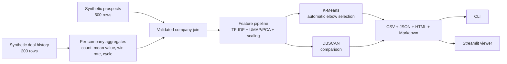

# Audience Segmentation Tool

[](https://github.com/cjf-iii/audience-segmentation-tool/actions/workflows/tests.yml)


An end-to-end, reproducible NLP pipeline that turns synthetic prospect and deal-history data into named audience segments, rule-based outreach guidance, and reviewable artifacts.

> Resume claim: Built an NLP segmentation pipeline for 500 prospects using TF-IDF, UMAP, K-Means, and DBSCAN; delivered CLI and Streamlit outputs with named clusters and outreach recommendations.

## Review it in five commands

```bash
uv sync --locked
uv run python -m unittest discover -s tests -v
uv run python generate_data.py
uv run python segment.py --input data/prospects.csv --deals data/deal_history.csv --clusters auto --output results
uv run python scripts/verify_artifacts.py
```

Then launch the same results through the interactive interface:

```bash
uv run streamlit run app.py
```

The project uses `uv` exclusively. `.python-version` pins Python 3.12 and `uv.lock` pins the complete environment.

## Executable reviewer notebook

[Open the raw-data-to-validation tutorial](notebooks/01_data_to_validation.ipynb), or launch it from the repository root:

```bash
uv sync --locked --group notebook
uv run --group notebook jupyter lab notebooks/01_data_to_validation.ipynb
```

The notebook degrades the generated prospect and deal exports, proves exact schema and row recovery, then executes the real TF-IDF/UMAP/K-Means/DBSCAN pipeline and repository tests. CI executes every cell without modifying the committed notebook.

## System design



The clustering matrix combines two reduced text representations with eight scaled numeric features:

- website descriptions and recent campaign text become TF-IDF vectors, then UMAP or PCA components;
- prospect revenue, employee count, social score, and estimated ad spend provide commercial context;
- actual aggregates from `deal_history.csv` add deal count, mean deal value, win rate, and mean sales-cycle duration.

K-Means is the primary segmentation method. DBSCAN is a comparison view, not an accuracy validator. Segment names and outreach text are deterministic rules derived from cluster profiles; they are not generated by an LLM.

## Output contract

The CLI always writes four artifacts to the selected output directory:

| Artifact | Review purpose |
|---|---|
| `segments.csv` | Source fields, deal aggregates, cluster assignment, name, and 2-D projection for all 500 prospects |
| `segment_profiles.json` | K-Means and DBSCAN profile summaries |
| `visualization.html` | Self-contained, interactive Plotly scatter plot |
| `report.md` | Human-readable profiles and rule-based outreach recommendations |

`scripts/verify_artifacts.py` fails closed if the row counts, deal integration, named profiles, projection columns, or visualization contract is broken. The integration test also runs the PCA pipeline twice and compares SHA-256 hashes for every artifact.

## CLI

```text
--input       Prospect CSV (default: data/prospects.csv)
--deals       Deal-history CSV (default: data/deal_history.csv)
--clusters    Integer or auto elbow selection (default: auto)
--output      Artifact directory (default: results/)
--no-umap     Use PCA instead of UMAP
--no-dbscan   Skip the DBSCAN comparison
--verbose     Enable debug logging
```

## Repository map

```text
.
├── .github/workflows/tests.yml  # public Ubuntu release gate
├── data/                        # generated and ignored
├── notebooks/01_data_to_validation.ipynb
├── pipeline/
│   ├── text_processor.py        # TF-IDF, reduction, numeric scaling
│   └── segmentation.py          # K-Means, DBSCAN, profiles, naming
├── results/                     # generated and ignored
├── scripts/verify_artifacts.py
├── tests/test_pipeline.py
├── app.py                       # Streamlit viewer
├── generate_data.py             # deterministic synthetic inputs
├── segment.py                   # shared CLI/app orchestration
├── pyproject.toml
└── uv.lock
```

## Evidence and boundaries

- The included generator creates fictional companies and transactions from authored templates. No performance claim is based on customer or employer data.
- Clusters are descriptive, not ground truth. Their usefulness must be evaluated with domain experts and downstream campaign outcomes before real use.
- Revenue, ad spend, and outreach guidance are illustrative. They are not financial forecasts or autonomous sales instructions.
- UMAP and K-Means are seeded. Exact repeatability is tested on the PCA path because native numerical libraries can introduce platform-level floating-point variation.
- The public GitHub workflow installs only from `uv.lock`, checks Ruff formatting and lint, runs integration tests, executes the full UMAP pipeline, validates artifacts, and smoke-tests Streamlit.

See [MODEL_CARD.md](MODEL_CARD.md) for intended use and limitations and [VERIFICATION.md](VERIFICATION.md) for the recorded release evidence.

## Local pre-push gate

GitHub Actions is authoritative. To run the same locked lint and test checks before a local push:

```bash
git config core.hooksPath .githooks
```

The committed hook invokes only `uv sync --locked` and `uv run`; it does not use a system Python environment.

## License

[MIT](LICENSE)
